# Multi-node

N duckbox daemons share one named-sandbox registry and coordinate **per-sandbox ownership** with S3 conditional writes. Sandboxes stay **in-process** (no process-per-sandbox, no cgroups). The daemon is still a control plane: its only S3 credential is the lease/registry prefix. Lake attach happens inside each sandbox at warmup.

DuckLake multi-node is **read-only**: `kind: ducklake` requires `read_only: true` (a writable lake is a spec-validation error). The shared catalog is Postgres; duckbox does not replicate or sync lake data between nodes. Catalog attach (an existing Postgres+S3 lake, no migration) is [docs/ducklake-compatibility.md](ducklake-compatibility.md) — not this multi-node e2e. If you put PgBouncer in front of a Postgres DuckLake catalog, use session pooling (transaction pooling breaks `SET search_path` / prepared catalog statements). That is a catalog-ops warning, not a duckbox feature.

If the catalog is unreachable after warmup (Postgres stopped, network partition, bad DSN), agent SQL — including `AT (VERSION => n)` — returns only the fixed client error `lake catalog unavailable; see operator logs`. duckbox decides that from the DuckDB error itself: an IO, CONNECTION, or HTTP exception type, or an unambiguous catalog marker DuckDB always emits with the DSN (`Unable to connect to Postgres`, `Failed to query most recent snapshot`, `failed to attach`). That is not a value oracle — the response does not depend on any guessed secret. A final safety net on every tenant-facing path (Flight, debug HTTP, Describe, prepared) replaces any remaining message that contains `password=`, URI userinfo (`scheme://user:pass@`), or the configured DSN with the same generic text, without substituting or echoing values. Every other tenant error is returned as-is; those messages only echo the tenant's own SQL. Tenant SQL that touches secrets (`CREATE`/`DROP SECRET`, `duckdb_secrets()`, `which_secret()`, and any secret-related function, setting, or pragma) is rejected by the rewriter. Operator logs of attach / catalog-IO failures keep the DuckDB detail after DSN and password redaction (exact configured values, then `password=` / URI / `CREATE SECRET` patterns). Warmup attach failures stay `ducklake catalog attach failed; see operator logs`.

## Architecture

```
   client ──► load balancer / any public Flight SQL listener
                    │
                    │  GetFlightInfo / DoGet (sandbox id + SQL)
                    ▼
              this node: Acquire sandbox id
                    │
          ┌─────────┴──────────┐
          │ owned locally?     │
          └─────────┬──────────┘
               yes  │   no
                    │    │
                    ▼    ▼
              warm DuckDB   proxy over internal listener
                    │       (peer secret, never the caller)
                    │         │
                    └────┬────┘
                         ▼
              FlightInfo to the client: empty locations
              (never a peer-internal address)
```

**Routing:** the client talks only to the node it hit (the load-balancer address is enough). A non-owner forwards Flight SQL (`GetFlightInfo`, `DoGet`, prepared statements) to the owner over the **internal** peer channel. Endpoint locations returned to the client are empty (same server) or the public node the client used — never `lease.advertise`. A draining node may still forward to a live owner but must not take new ownership. A request already sent to an old owner is **not** replayed onto a new owner.

`RedirectError` is an internal proxy trigger. It is never returned to clients.

Prepared-statement handles are HMAC tokens (SQL + sandbox id + version) and are valid on the owner; re-prepare is also fine. v1 checks S3 ownership on every `SandboxRuntime::Get` (every query).

## Separate the listeners

Each daemon binds **two** Flight servers:

| Plane | Config | Serves |
| --- | --- | --- |
| **Public** | `listen` (clients / load balancer) | Flight SQL + sandbox CRUD (`CreateSandbox` … `ExpireSandbox`) |
| **Internal** | `internal_listen` (default loopback, public port+1000) | Node-to-node proxy/peer protocol + operator API (`DrainNode`, `NodeStatus`) |

The public Flight SQL listener must **not** serve `DrainNode`, `NodeStatus`, or peer calls. `lease.advertise` is the **internal** address peers dial.

**Never expose the internal listener publicly.** Bind it to loopback, a private network, or an encrypted overlay (WireGuard, a VPC, a mesh). A non-loopback `listen` or an explicit `lease.advertise` requires `internal_listen` in the YAML (or `--internal-listen`) so the internal port cannot accidentally share the public bind.

Peer calls authenticate with a **shared peer secret** from `auth.peer_secret_ref` (`env:` or `file:` only). The value is resolved into memory and is never stored as plaintext in YAML (`auth.peer_secret` is rejected). The caller’s bearer is not forwarded.

The identity `"peer"` is **reserved**. It is granted only when the request presents the peer secret on the **internal** listener. A JWT `sub=peer`, an `auth.bearer_secrets` identity of `peer`, or `x-duckbox-caller: peer` is rejected. The peer secret must be at least 16 characters (leading/trailing whitespace trimmed); a `file:` secret that is world-readable is refused.

**TLS between peers:** set `lease.advertise` to a `grpc+tls://host:port` URL (parsed with Arrow `Location::Parse`). Put the internal listener on a private network or overlay, and terminate TLS there (or use mTLS at the mesh / load balancer). The peer secret is a bearer on that channel — it is not a substitute for transport encryption. duckbox does not currently load custom peer TLS certs from YAML; use `grpc+tls://` plus the platform’s default trust store, or wrap the internal port in a sidecar/mesh.

## Self-fencing

The **node lease** (heartbeat object `{prefix}nodes/{node_id}.json`) is the fence, not each sandbox lease.

- Renew at about **1/3 of TTL** (`lease.heartbeat`, default `ttl/3`).
- A failed renewal is retried while the **published expiry** has not passed (a short S3 blip must not fence).
- When the published expiry passes, **or** the node lease record is gone / does not match what this process published: **fence**.
- Fence: interrupt every in-flight statement, passivate every sandbox, fail subsequent requests, log a JSON `self_fence` event, exit **3**. Fence writes nothing (no lease Release, no heartbeat delete).
- Every routed request calls `AssertServing` so a request is refused if expiry has already passed, even before the watchdog tick.
- A 412 on the node heartbeat is **re-read**. The process fences if the S3 record is missing, belongs to a different `node_id`, or carries a different per-process `instance_id`. A restart of the same `node_id` takes over via If-Match (registration is idempotent) and writes a new `instance_id`; the previous process then fences instead of coexisting. `nodes/{id}.json` is not deleted on crash; SIGTERM drains, tombstones owned sandbox leases, then deregisters.

A sandbox lease renew failure (412, epoch mismatch, transport) interrupts in-flight SQL for **that** sandbox, then passivates it.

### The supervisor

Do **not** stay alive unhealthy. Run the daemon under a supervisor that restarts it:

- systemd (`Restart=always`)
- Docker (`restart: unless-stopped` / `always`)
- Kubernetes (pod restart)

Use **unlimited restarts**. After SIGKILL or an S3 outage longer than TTL, every node self-fences (exit 3). Once S3 is healthy, the supervisor must start the same `node_id` again; startup **takes over** the existing node record (If-Match) instead of crashing on If-None-Match `*`.

`SIGINT` / `SIGTERM` are owned by duckbox (blocked in every thread, delivered to a `sigwait` thread). The first signal stops renew, drains, deregisters, and shuts down both Flight listeners with a deadline (exit 0). A second signal `_Exit`s immediately. Do not rely on Arrow `SetShutdownOnSignals` — a second `Serve()` thread would swallow the handler.

Size `lease.ttl` **strictly larger than the longest S3 blip you will tolerate without a restart**, and size the supervisor restart delay **at least one TTL** so a fenced node cannot race a peer that is stealing expired sandbox leases. Example: if object storage can pause for 30s, set TTL to 45s+ (heartbeat ~TTL/3). An outage shorter than TTL is retried; an outage longer than TTL is a fence + restart. `SelfFence` is exit 3 so the supervisor and alerts see a crash-restart, not a hanging process.

## Lease lifecycle

```mermaid
stateDiagram-v2
    [*] --> Free: no object
    Free --> Owned: If-None-Match:* epoch=1
    Owned --> Owned: If-Match renew (same epoch, new expiry)
    Owned --> Free: If-Match tombstone (drain / release; epoch kept)
    Owned --> Stolen: expiry passed, peer If-Match epoch++
    Stolen --> Owned: new owner renews
    Owned --> Lost: renew 412 / epoch mismatch
    Lost --> [*]: stop serving that sandbox, passivate
    Owned --> Fenced: node lease expiry / mismatch
    Fenced --> [*]: interrupt all, passivate all, exit 3
```



- **Acquire** (If-None-Match `*`): create epoch 1. If another node **or another process of this `node_id`** holds an unexpired lease, return `owned_locally=false` (proxy) and wait for TTL / fence / release — do not take over a live record. If expired or tombstoned (`owner_id` empty), steal with If-Match and `epoch++` (fencing token). Draining nodes do not take new leases. A missing object whose `{prefix}epochs/{id}.json` is corrupt is refused (fail closed) so epoch cannot reset to 1.
- **Renew** (If-Match on the **locally remembered** lease): bump `expiry_ms`, keep epoch. Verifies `owner_id == self`. Failure is `LeaseLostError`; the renew thread interrupts then passivates that sandbox. Never `Renew(Peek)` — Peek is the current S3 owner and would make the etag/epoch check tautological.
- **Release** (If-Match **tombstone**): clear `owner_id` / `flight` / `expiry_ms` / `instance_id`, set `released_ms`, **keep epoch**. Drain uses remembered leases only, so it cannot delete another node’s live record. Epoch never resets on release; the next acquire is `epoch+1`.
- **Tombstone GC**: tombstones older than `lease.gc` (default 24h) are deleted only after the current epoch is written to `{prefix}epochs/{id}.json`. Acquire of a missing object reads that marker so epoch stays monotonic. GC never deletes a tombstone if the marker write failed or would store a smaller epoch. `lease.gc: 0` disables GC. Tombstones without `released_ms` are stamped first and wait a full `gc` interval.
- Check ownership on every `SandboxRuntime::Get` (every query path), with a short optional `lease.cache_ms` window. Proxy dials consult `IsKnownFlight`, which uses a short-TTL node-directory cache (positive and negative) and lists S3 only when that snapshot has expired.

`epoch` is **not** included in lake writes. The real guarantees are: (1) CAS on the S3 lease object (If-Match / If-None-Match + monotonic epoch) so a stale owner cannot keep or silently reclaim the record; (2) the node self-fence so a process that lost its node lease stops serving. DuckLake / catalog rows do not carry the epoch.

Heartbeat records live next to leases: `{prefix}nodes/{node_id}.json` (`node_id`, `flight` = internal advertise URL, `started_at_ms`, `version`, `expiry_ms`, `instance_id`). Peers `ListKeys` that prefix and ignore expired rows. Each process generates an `instance_id` at start and writes it on the node record and on every sandbox lease it holds. A second process with the same `node_id` takes over the **node** record (If-Match); the first fences when it sees a different `instance_id`. Live **sandbox** leases stay with the instance that holds them until TTL, fence, or release.

## Config keys

Under `lease:` in the daemon YAML (all optional except the S3 endpoint block you already use):

| Key | Default | Meaning |
| --- | --- | --- |
| `endpoint` / `endpoint_env` | (none) | Control-plane S3. Empty → `SingleNodeLeaseManager` (memory / one node). |
| `bucket` | required if endpoint set | Lease + registry bucket. |
| `prefix` | `leases/` | Object prefix. Ownership is `{prefix}ownership/{id}.json`. |
| `access_key_env` / `secret_key_env` | required for static keys | Refs only. Not used with `provider: credential_chain`. |
| `provider` | `config` | `config` (static keys) or `credential_chain` (SDK profile / assume-role / default chain, including IRSA web identity). |
| `profile` / `role_arn` | optional | Only with `credential_chain`. `role_arn` always uses `STSAssumeRoleCredentialsProvider` (fail closed if the STS SDK is not linked). A named profile is not a substitute. |
| `skip_probe` | `false` | Skip If-None-Match startup probe (`{prefix}.duckbox-cw-probe-<node_id>-<nonce>`). |
| `node_id` | daemon `name` | Must be unique in the cluster. `[A-Za-z0-9._-]`, at most 128 bytes (S3 probe key). |
| `ttl` / `ttl_ms` | `15s` | Lease and heartbeat TTL. Must exceed the longest S3 blip you want to survive without a restart. |
| `heartbeat` / `heartbeat_ms` | `ttl/3` (min 1s) | Node-lease renew interval. |
| `skew` / `skew_ms` | `1s` | Extra wait past `expiry_ms` before stealing another node’s lease (local-clock skew margin). |
| `cache_ms` | `250` | Short Acquire cache (also caps the node-directory lookup cache). `0` disables the Acquire cache; directory lookups then use a 1s TTL. Must stay well below TTL. |
| `gc` / `gc_ms` | `24h` | Age after which a lease tombstone may be deleted. Epoch is copied to `{prefix}epochs/{id}.json` first. `0` disables. |
| `proxy_timeout` / `proxy_timeout_ms` | `5s` | Deadline for peer **connect**, Authenticate handshake, and GetFlightInfo (and other unary peer RPCs). Not a deadline for the proxied DoGet stream after the owner has sent its first Flight message (schema). Connect and Authenticate do not hold a process-wide lock: a frozen peer cannot stall proxy calls to a different, healthy owner. |
| `proxy_first_message_max` / `proxy_first_message_max_ms` | `60s` | Ceiling for how long a proxied DoGet waits for the owner's first message when the sandbox `query_timeout_ms` is `0`. Must be > 0. |
| `proxy_max_inflight` | `64` | Cap on concurrent proxied DoGets. Further calls fail immediately with `peer proxy busy` (Arrow `CapacityError` / gRPC ResourceExhausted). Must be > 0. |
| `max_leases` | `0` (unlimited) | Optional cap of sandboxes this node will own. |

**Proxied DoGet (first message, cancel, keepalive):**

- The owner runs the query before it sends a schema. The proxy therefore waits for that first Flight message with a **finite bound**: `query_timeout_ms + proxy_timeout_ms` when `query_timeout_ms > 0`, otherwise `proxy_first_message_max_ms` (default 60s). A frozen or silent owner fails the proxied call with the fixed client error `peer proxy timed out` within that bound. After the schema arrives, the stream has no extra gRPC deadline.
- Client cancel or disconnect tears down the **upstream gRPC call** immediately, including while it is still waiting for the first message. Arrow `ServerCallContext` exposes only `is_cancelled()` (no completion-queue callback), so **one process-wide watcher thread** (not one thread per stream) polls that flag and the first-message deadline (`wait_until`). It calls `ClientDataStream::TryCancel()` on the cached per-peer transport. The client sees the fixed error `peer proxy cancelled`. Upstream status is logged server-side only; peer addresses are never returned.
- On the owner, the same shared watcher calls DuckDB `Interrupt` when `context.is_cancelled()` so the in-flight query stops. The owner then finishes the RPC instead of running the statement to completion.
- Node-to-node channels use fixed gRPC keepalive (plaintext stays the default): client `KEEPALIVE_TIME_MS=10000`, `KEEPALIVE_TIMEOUT_MS=5000`, `KEEPALIVE_PERMIT_WITHOUT_CALLS=1`. The internal listener allows those pings (`HTTP2_MIN_RECV_PING_INTERVAL_WITHOUT_DATA_MS=5000`, `HTTP2_MAX_PING_STRIKES=0`). A SIGSTOPped owner is dropped when keepalive fails or the first-message bound fires.
- SIGTERM cancels in-flight peer streams first so hung proxied DoGets unblock and the process can exit. The first signal still drains with a Flight shutdown deadline; a 3s watchdog `_Exit`s if Arrow shutdown sticks, and a second signal `_Exit`s immediately.
- The peer client/transport cache is one Flight client and one gRPC transport per peer URL. Connect and Authenticate do not hold the cache lock. Concurrent proxied DoGets are capped by `proxy_max_inflight`. Cancelled stream objects are kept in a 256-entry graveyard (Arrow #31235); they do not grow without bound.

Startup lists `{prefix}.duckbox-cw-probe-<node_id>-` and deletes leftover objects whose remainder is a 16-hex nonce and whose `LastModified` is older than five minutes (crash between PUT and DELETE). In-flight probes — including another process of the same `node_id`, or a longer id such as `a-b` when this node is `a` — are left alone. A list failure is logged (`s3_list` / `lease_probe_list`) and does not fail startup. Each DELETE is logged (`lease_probe_delete`). Nodes need **NTP-synced clocks** for that five-minute cutoff: cleanup compares S3 `LastModified` to the local clock. A node more than five minutes ahead can delete a peer's in-flight probe; a node behind leaves stale objects longer.

Top-level / `auth:`:

| Key | Default | Meaning |
| --- | --- | --- |
| `internal_listen` | loopback, public port+1000 | Internal peer/operator bind. Required when `listen` is not loopback or `lease.advertise` is set. |
| `auth.operators` | empty (deny all) | Identities allowed to `DrainNode` / `NodeStatus`. |
| `auth.peer_secret_ref` | required when `internal_listen` is set with a lease endpoint | `env:` or `file:` only. Never a plaintext value. Single-node S3 registry (no `internal_listen`) does not need it. |

All nodes **must share** `handle_secret` (HMAC handles), the lease prefix, and the peer secret. They should not share lake credentials on the daemon.

Example cluster files: `daemons/cluster-node-a.yaml`, `cluster-node-b.yaml`, `cluster-node-c.yaml` (5s TTL for local failover demos; production usually 15s).

## How to add a node

1. Copy a cluster YAML. Set unique `name`, `listen`, `internal_listen`, `metrics.listen`, `lease.node_id`, `lease.advertise` (internal).
2. Point `lease.endpoint` / `bucket` / `prefix` at the **same** control bucket. Same `auth.peer_secret_ref`.
3. Start it: `./build/duckbox serve --daemon ./daemons/cluster-node-c.yaml`
4. No rebalancing. The new node takes leases only when they are free or expired (or after a drain). `max_leases` is optional.

## How to remove / drain a node

```bash
duckbox node drain --url grpc://127.0.0.1:5748 --timeout 5000
duckbox node drain --url grpc://127.0.0.1:5748 --token "$JWT"
duckbox node drain --url grpc://127.0.0.1:5748 --peer-secret env:DUCKBOX_PEER_SECRET
```

`--url` is the **internal** listener. `DrainNode` on the public listener is rejected. `--token` (or `DUCKBOX_TOKEN`) sends `Authorization: Bearer` (JWT / bearer secret). `--peer-secret` handshakes with the peer secret (`env:` / `file:` / literal). The token is never logged.

`DrainNode` is a **node-admin** action. The AI agent is an authenticated caller and must not drain a node. Authorization is `auth.operators` in the daemon YAML (deny by default: an empty list denies everyone, including under `allow_insecure_dev`). Cluster examples list `local` so `duckbox node drain --caller local` works. `auth.callers` (sandbox CRUD) is a separate list — an analyst identity can create sandboxes and still be denied DrainNode.

`DrainNode` (internal Flight DoAction):

1. `AuthorizeOperator` — reject non-operators.
2. Stop taking **new** leases and persist `draining: true` on the node record (so a later heartbeat cannot re-register as live).
3. Wait up to `timeout_ms` (cap 60s) for the in-flight request counter to reach zero.
4. Tombstone owned leases (If-Match, remembered etag, `owner_id == self`) so peers can acquire.
5. Passivate local DuckDB instances.
6. SIGTERM also deregisters the heartbeat object after drain.

Then stop the process (`SIGINT` / `SIGTERM`). Clients that still hit this node after release are proxied to the new owner (or get a retryable error if none is up yet). An ownerless sandbox during drain does **not** return an empty advertise URL.

The proxy validates `lease.flight` against the live node directory before dialing, and returns a generic `peer proxy failed` to clients (peer address is logged server-side only).

## Crash / partition

If a process dies, heartbeats and leases expire after `ttl`. Another node acquires the sandbox, loads the definition from the S3 registry, and warms DuckDB (attach lake, then lock_configuration). Clients keep talking to whatever public node they already use; that node proxies to the new owner after expiry.

A renew failure on a sandbox (412, epoch mismatch, or transport error) interrupts then passivates **that** sandbox only, before its TTL expires. Epoch is a CAS fencing token on the S3 lease object only; it is not written into the lake.

A failed **node heartbeat** PUT does **not** immediately exit. While the published expiry is still in the future, the node retries. When expiry passes (or the record is missing / a **different** `node_id` or `instance_id`), it self-fences and exits 3. An S3 blip shorter than TTL does not fence. An S3 outage longer than TTL fences every node; the supervisor restarts them and they take over their own `node_id` once S3 returns. Two processes with the same `node_id` cannot coexist: the new process takes over the record, the old process fences.

## Clock skew

Steal compares `expiry_ms` in the object to the node's local clock (injectable in tests), plus `lease.skew` (default 1s). A node is treated as expired only when `expiry_ms + skew_ms <= now`, which delays an early steal if our clock is ahead. If B is **behind**, failover is delayed by TTL plus skew. Keep NTP (or equivalent) within a small fraction of `lease.ttl`. The lease-probe leftover cutoff (five minutes, `LastModified`) also uses the local clock — keep nodes NTP-synced so one node cannot treat another's in-flight probe as stale. duckbox does not wait on a centralized clock.

## Limits

- All sandboxes of one node share one process (memory/CPU). `limits.max_sandboxes` and optional `lease.max_leases` cap ownership, not OS isolation.
- One `/metrics` per node (`duckbox_owned_keys`, `duckbox_node_healthy` = published lease live, `duckbox_node_lease_renewals_total`, `duckbox_ownership_acquired_total{reason="handoff"}` takeovers, `duckbox_proxy_requests_total`, `duckbox_proxy_errors_total`, `duckbox_proxy_seconds`, `duckbox_cluster_nodes`). Debug HTTP `/health` includes `healthy` / `serving` / `fenced` / `draining` (503 when not serving).
- `sandbox list` is cluster-wide (S3 registry) and sets `owner` from the live lease.
- No lake sync, no cgroups, no process-per-sandbox.

## Local runbook (2–3 daemons, RustFS)

From the repo root, after a normal build (`make build` / cmake).

```bash
docker compose up -d --wait

export DUCKBOX_HANDLE_SECRET=duckbox-dev-secret
export DUCKBOX_PEER_SECRET=duckbox-peer-dev
export DUCKBOX_S3_KEY=rustfsadmin
export DUCKBOX_S3_SECRET=rustfsadmin

python3 -m venv .venv
.venv/bin/pip install -r examples/python/requirements.txt
# control-plane bucket only (seed_ducklake.py also creates it if you use DuckLake)
.venv/bin/python - <<'PY'
import boto3
from botocore.config import Config
from botocore.exceptions import ClientError
c = boto3.client("s3", endpoint_url="http://127.0.0.1:9000",
    aws_access_key_id="rustfsadmin", aws_secret_access_key="rustfsadmin",
    region_name="us-east-1", config=Config(s3={"addressing_style": "path"}))
try:
    c.create_bucket(Bucket="duckbox-control")
except ClientError as e:
    if e.response.get("Error", {}).get("Code") not in ("BucketAlreadyOwnedByYou", "BucketAlreadyExists"):
        raise
PY

./build/duckbox serve --daemon ./daemons/cluster-node-a.yaml &
./build/duckbox serve --daemon ./daemons/cluster-node-b.yaml &
./build/duckbox serve --daemon ./daemons/cluster-node-c.yaml &
# wait until public 4747/4748/4749 and internal 5747/5748/5749 accept connections

./build/duckbox sandbox create --url grpc://127.0.0.1:4747 \
  --spec ./policies/memory/analyst.yaml \
  --id cluster-analyst --key tenant_21:user_sergio

./build/duckbox sandbox list --url grpc://127.0.0.1:4748
# owner is node-a after the first query/warmup

PYTHONPATH=./examples/python .venv/bin/python - <<'PY'
from duckbox_client import connect
db = connect(sandbox="cluster-analyst", key="tenant_21:user_sergio", url="grpc://127.0.0.1:4748")
print(db.query("SELECT id, title FROM deals ORDER BY id"))
PY

# crash the owner; clients on another public listener keep working after TTL
# (the live node proxies, then acquires):
# kill %1   # node-a
# PYTHONPATH=./examples/python .venv/bin/python -c "from duckbox_client import connect; ..."

# graceful remove (internal listener):
./build/duckbox node drain --url grpc://127.0.0.1:5748
# or: --token "$JWT" / --peer-secret env:DUCKBOX_PEER_SECRET
```

CI runs the same flow as `scripts/e2e_multi_node.sh` (create bucket, three daemons, query via a non-owner, kill owner, query, drain on the internal listener, query).
