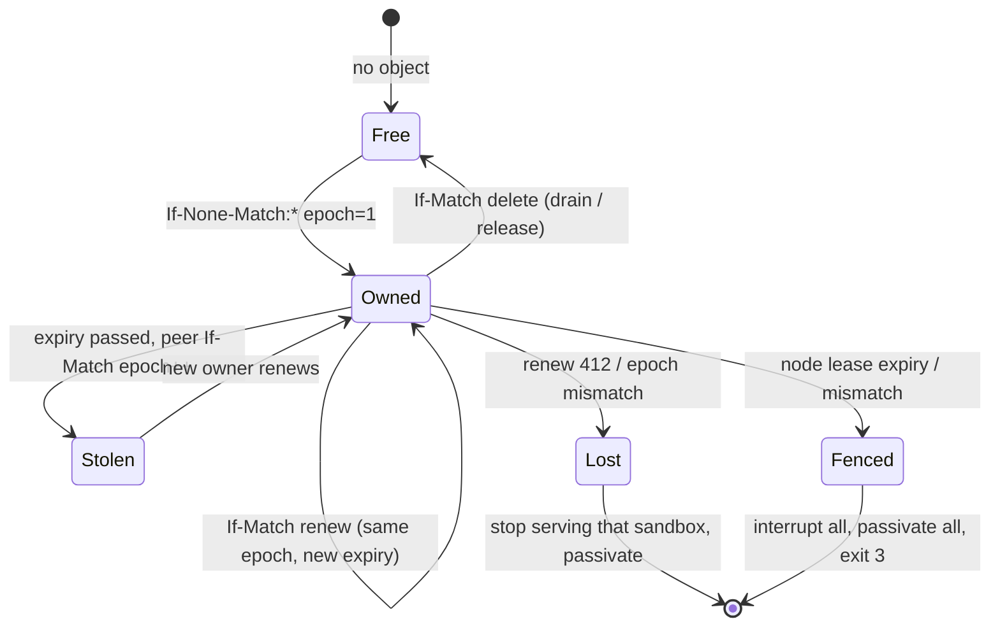

# Multi-node

N duckbox daemons share one named-sandbox registry and coordinate **per-sandbox ownership** with S3 conditional writes. Sandboxes stay **in-process** (no process-per-sandbox, no cgroups). The daemon is still a control plane: its only S3 credential is the lease/registry prefix. Lake attach happens inside each sandbox at warmup.

DuckLake multi-node is **read-only or a Postgres catalog**. duckbox does not replicate or sync lake data between nodes. If you put PgBouncer in front of a Postgres DuckLake catalog, use session pooling (transaction pooling breaks `SET search_path` / prepared catalog statements). That is a catalog-ops warning, not a duckbox feature.

## Architecture

```
   client ──► load balancer / any public Flight SQL listener
                    │
                    │  GetFlightInfo / DoGet (sandbox id + SQL)
                    ▼
              this node: Acquire sandbox id
                    │
          ┌─────────┴──────────┐
          │ owned locally?     │
          └─────────┬──────────┘
               yes  │   no
                    │    │
                    ▼    ▼
              warm DuckDB   proxy over internal listener
                    │       (peer secret, never the caller)
                    │         │
                    └────┬────┘
                         ▼
              FlightInfo to the client: empty locations
              (never a peer-internal address)
```

**Routing:** the client talks only to the node it hit (the load-balancer address is enough). A non-owner forwards Flight SQL (`GetFlightInfo`, `DoGet`, prepared statements) to the owner over the **internal** peer channel. Endpoint locations returned to the client are empty (same server) or the public node the client used — never `lease.advertise`. A draining node may still forward to a live owner but must not take new ownership. A request already sent to an old owner is **not** replayed onto a new owner.

`RedirectError` is an internal proxy trigger. It is never returned to clients.

Prepared-statement handles are HMAC tokens (SQL + sandbox id + version) and are valid on the owner; re-prepare is also fine. v1 checks S3 ownership on every `SandboxRuntime::Get` (every query).

## Separate the listeners

Each daemon binds **two** Flight servers:

| Plane | Config | Serves |
| --- | --- | --- |
| **Public** | `listen` (clients / load balancer) | Flight SQL + sandbox CRUD (`CreateSandbox` … `ExpireSandbox`) |
| **Internal** | `internal_listen` (default loopback, public port+1000) | Node-to-node proxy/peer protocol + operator API (`DrainNode`, `NodeStatus`) |

The public Flight SQL listener must **not** serve `DrainNode`, `NodeStatus`, or peer calls. `lease.advertise` is the **internal** address peers dial.

**Never expose the internal listener publicly.** Bind it to loopback, a private network, or an encrypted overlay (WireGuard, a VPC, a mesh). A non-loopback `listen` or an explicit `lease.advertise` requires `internal_listen` in the YAML (or `--internal-listen`) so the internal port cannot accidentally share the public bind.

Peer calls authenticate with a **shared peer secret** from `auth.peer_secret_ref` (`env:` or `file:` only). The value is resolved into memory and is never stored as plaintext in YAML (`auth.peer_secret` is rejected). The caller’s bearer is not forwarded.

## Self-fencing

The **node lease** (heartbeat object `{prefix}nodes/{node_id}.json`) is the fence, not each sandbox lease.

- Renew at about **1/3 of TTL** (`lease.heartbeat`, default `ttl/3`).
- A failed renewal is retried while the **published expiry** has not passed (a short S3 blip must not fence).
- When the published expiry passes, **or** the node lease record is gone / does not match what this process published: **fence**.
- Fence: interrupt every in-flight statement, passivate every sandbox, fail subsequent requests, log `SELF-FENCE:`, exit **3**. Fence writes nothing (no lease Release, no heartbeat delete).
- Every routed request calls `AssertServing` so a request is refused if expiry has already passed, even before the watchdog tick.

A sandbox lease renew failure (412, epoch mismatch, transport) still passivates **that** sandbox only.

### The supervisor

Do **not** stay alive unhealthy. Run the daemon under a supervisor that restarts it:

- systemd (`Restart=always`)
- Docker (`restart: unless-stopped` / `always`)
- Kubernetes (pod restart)

Use **unlimited restarts** and a delay of **at least one lease TTL** between attempts so a fenced node cannot race a peer that is stealing expired sandbox leases. `SelfFence` is exit 3 so the supervisor and alerts see a crash-restart, not a hanging process.

## Lease lifecycle



- **Acquire** (If-None-Match `*`): create epoch 1. If another node holds an unexpired lease, return `owned_locally=false` (proxy). If expired, steal with If-Match and `epoch++` (fencing token). Draining nodes do not take new leases.
- **Renew** (If-Match): bump `expiry_ms`. Failure is `LeaseLostError`; the renew thread passivates that sandbox. A stale owner cannot keep serving.
- **Release** (If-Match delete): drain and explicit release.
- Check ownership on every `SandboxRuntime::Get` (every query path).

Heartbeat records live next to leases: `{prefix}nodes/{node_id}.json` (`node_id`, `flight` = internal advertise URL, `started_at_ms`, `version`, `expiry_ms`). Peers `ListKeys` that prefix and ignore expired rows.

## Config keys

Under `lease:` in the daemon YAML (all optional except the S3 endpoint block you already use):

| Key | Default | Meaning |
| --- | --- | --- |
| `endpoint` / `endpoint_env` | (none) | Control-plane S3. Empty → `SingleNodeLeaseManager` (memory / one node). |
| `bucket` | required if endpoint set | Lease + registry bucket. |
| `prefix` | `leases/` | Object prefix. Ownership is `{prefix}ownership/{id}.json`. |
| `access_key_env` / `secret_key_env` | required if endpoint set | Refs only. |
| `skip_probe` | `false` | Skip If-None-Match startup probe. |
| `node_id` | daemon `name` | Must be unique in the cluster. |
| `advertise` | `grpc://` + `internal_listen` | **Internal** URL peers dial. Use a reachable private host, not `0.0.0.0`. |
| `ttl` / `ttl_ms` | `15s` | Lease and heartbeat TTL. |
| `heartbeat` / `heartbeat_ms` | `ttl/3` (min 1s) | Node-lease renew interval. |
| `max_leases` | `0` (unlimited) | Optional cap of sandboxes this node will own. |

Top-level / `auth:`:

| Key | Default | Meaning |
| --- | --- | --- |
| `internal_listen` | loopback, public port+1000 | Internal peer/operator bind. Required when `listen` is not loopback or `lease.advertise` is set. |
| `auth.operators` | empty (deny all) | Identities allowed to `DrainNode` / `NodeStatus`. |
| `auth.peer_secret_ref` | required if lease endpoint set | `env:` or `file:` only. Never a plaintext value. |

All nodes **must share** `handle_secret` (HMAC handles), the lease prefix, and the peer secret. They should not share lake credentials on the daemon.

Example cluster files: `daemons/cluster-node-a.yaml`, `cluster-node-b.yaml`, `cluster-node-c.yaml` (5s TTL for local failover demos; production usually 15s).

## How to add a node

1. Copy a cluster YAML. Set unique `name`, `listen`, `internal_listen`, `metrics.listen`, `lease.node_id`, `lease.advertise` (internal).
2. Point `lease.endpoint` / `bucket` / `prefix` at the **same** control bucket. Same `auth.peer_secret_ref`.
3. Start it: `./build/duckbox serve --daemon ./daemons/cluster-node-c.yaml`
4. No rebalancing. The new node takes leases only when they are free or expired (or after a drain). `max_leases` is optional.

## How to remove / drain a node

```bash
duckbox node drain --url grpc://127.0.0.1:5748 --timeout 5000
```

`--url` is the **internal** listener. `DrainNode` on the public listener is rejected.

`DrainNode` is a **node-admin** action. The AI agent is an authenticated caller and must not drain a node. Authorization is `auth.operators` in the daemon YAML (deny by default: an empty list denies everyone, including under `allow_insecure_dev`). Cluster examples list `local` so `duckbox node drain --caller local` works. `auth.callers` (sandbox CRUD) is a separate list — an analyst identity can create sandboxes and still be denied DrainNode.

`DrainNode` (internal Flight DoAction):

1. `AuthorizeOperator` — reject non-operators.
2. Stop taking **new** leases.
3. Wait up to `timeout_ms` (cap 60s) so in-flight queries can finish.
4. Release owned leases (If-Match delete) so peers can acquire.
5. Passivate local DuckDB instances.
6. Delete the heartbeat object.

Then stop the process (`SIGINT`). Clients that still hit this node after release are proxied to the new owner (or fail if none is up yet).

## Crash / partition

If a process dies, heartbeats and leases expire after `ttl`. Another node acquires the sandbox, loads the definition from the S3 registry, and warms DuckDB (initSQL reruns). Clients keep talking to whatever public node they already use; that node proxies to the new owner after expiry.

A renew failure on a sandbox (412, epoch mismatch, or transport error) passivates **that** sandbox only, before its TTL expires. Epoch fencing stays the write-side correctness guarantee: a stolen lease bumps `epoch`, so a stale writer cannot keep the lake.

A failed **node heartbeat** PUT does **not** immediately exit. While the published expiry is still in the future, the node retries. When expiry passes (or the record is missing/mismatched), it self-fences and exits 3. An S3 blip shorter than TTL does not fence.

## Clock skew

Steal compares `expiry_ms` in the object to the node's local clock (injectable in tests). If node B's clock is **ahead** of A by more than the remaining TTL, B may steal early. If B is **behind**, failover is delayed. Keep NTP (or equivalent) within a small fraction of `lease.ttl` (a few seconds if TTL is 15s). duckbox does not wait on a centralized clock.

## Limits

- All sandboxes of one node share one process (memory/CPU). `limits.max_sandboxes` and optional `lease.max_leases` cap ownership, not OS isolation.
- One `/metrics` per node (`duckbox_owned_keys`, `duckbox_node_healthy` = published lease live, `duckbox_node_lease_renewals_total`, `duckbox_ownership_acquired_total{reason="handoff"}` takeovers, `duckbox_proxy_requests_total`, `duckbox_proxy_errors_total`, `duckbox_proxy_seconds`, `duckbox_cluster_nodes`). Debug HTTP `/health` includes `healthy` / `serving` / `fenced` / `draining` (503 when not serving).
- `sandbox list` is cluster-wide (S3 registry) and sets `owner` from the live lease.
- No lake sync, no cgroups, no process-per-sandbox.

## Local runbook (2–3 daemons, RustFS)

From the repo root, after a normal build (`make build` / cmake).

```bash
docker compose up -d --wait

export DUCKBOX_HANDLE_SECRET=duckbox-dev-secret
export DUCKBOX_PEER_SECRET=duckbox-peer-dev
export DUCKBOX_S3_KEY=rustfsadmin
export DUCKBOX_S3_SECRET=rustfsadmin

python3 -m venv .venv
.venv/bin/pip install -r examples/python/requirements.txt
# control-plane bucket only (seed_ducklake.py also creates it if you use DuckLake)
.venv/bin/python - <<'PY'
import boto3
from botocore.config import Config
from botocore.exceptions import ClientError
c = boto3.client("s3", endpoint_url="http://127.0.0.1:9000",
    aws_access_key_id="rustfsadmin", aws_secret_access_key="rustfsadmin",
    region_name="us-east-1", config=Config(s3={"addressing_style": "path"}))
try:
    c.create_bucket(Bucket="duckbox-control")
except ClientError as e:
    if e.response.get("Error", {}).get("Code") not in ("BucketAlreadyOwnedByYou", "BucketAlreadyExists"):
        raise
PY

./build/duckbox serve --daemon ./daemons/cluster-node-a.yaml &
./build/duckbox serve --daemon ./daemons/cluster-node-b.yaml &
./build/duckbox serve --daemon ./daemons/cluster-node-c.yaml &
# wait until public 4747/4748/4749 and internal 5747/5748/5749 accept connections

./build/duckbox sandbox create --url grpc://127.0.0.1:4747 \
  --spec ./policies/memory/analyst.yaml \
  --id cluster-analyst --key tenant_21:user_sergio

./build/duckbox sandbox list --url grpc://127.0.0.1:4748
# owner is node-a after the first query/warmup

PYTHONPATH=./examples/python .venv/bin/python - <<'PY'
from duckbox_client import connect
db = connect(sandbox="cluster-analyst", key="tenant_21:user_sergio", url="grpc://127.0.0.1:4748")
print(db.query("SELECT id, title FROM deals ORDER BY id"))
PY

# crash the owner; clients on another public listener keep working after TTL
# (the live node proxies, then acquires):
# kill %1   # node-a
# PYTHONPATH=./examples/python .venv/bin/python -c "from duckbox_client import connect; ..."

# graceful remove (internal listener):
./build/duckbox node drain --url grpc://127.0.0.1:5748
```

CI runs the same flow as `scripts/e2e_multi_node.sh` (create bucket, three daemons, query via a non-owner, kill owner, query, drain on the internal listener, query).
