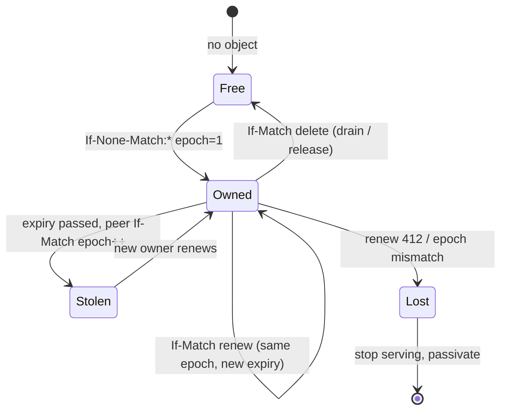

# Multi-node

N duckbox daemons share one named-sandbox registry and coordinate **per-sandbox ownership** with S3 conditional writes. Sandboxes stay **in-process** (no process-per-sandbox, no cgroups). The daemon is still a control plane: its only S3 credential is the lease/registry prefix. Lake attach happens inside each sandbox at warmup.

DuckLake multi-node is **read-only or a Postgres catalog**. duckbox does not replicate or sync lake data between nodes. If you put PgBouncer in front of a Postgres DuckLake catalog, use session pooling (transaction pooling breaks `SET search_path` / prepared catalog statements). That is a catalog-ops warning, not a duckbox feature.

## Architecture

```
                    ┌─────────────┐
   any node ───────►│  Flight SQL │  GetFlightInfo
                    │  (control)  │  endpoints → owner Location
                    └──────┬──────┘
                           │ Acquire sandbox id
                           ▼
              S3 duckbox-control / leases/
                 ownership/{id}.json     If-None-Match create
                 nodes/{node_id}.json    heartbeat + TTL
                 sandboxes/{id}/…        registry (any node)
                           │
                           ▼
              owner warms DuckDB in this process
```

**Routing choice:** GetFlightInfo puts the owner's `grpc://host:port` on the Flight endpoint `locations`. ADBC / Flight SQL clients follow that for DoGet. Prepared-statement handles are HMAC tokens (SQL + sandbox id + version) and are valid on the new owner; re-prepare is also fine. If a node still executes locally and is not the owner, it returns `duckbox redirect owner=<id> location=<url>` (`RedirectError`). The Python helper reconnects once on that message.

## Lease lifecycle



- **Acquire** (If-None-Match `*`): create epoch 1. If another node holds an unexpired lease, return `owned_locally=false` (redirect). If expired, steal with If-Match and `epoch++` (fencing token).
- **Renew** (If-Match): bump `expiry_ms`. Failure is `LeaseLostError`; the renew thread passivates that sandbox. A stale owner cannot keep serving.
- **Release** (If-Match delete): drain and explicit release.
- Check ownership on every `SandboxRuntime::Get` (every query path).

Heartbeat records live next to leases: `{prefix}nodes/{node_id}.json` (`node_id`, `flight`, `started_at_ms`, `version`, `expiry_ms`). Peers `ListKeys` that prefix and ignore expired rows.

## Config keys

Under `lease:` in the daemon YAML (all optional except the S3 endpoint block you already use):

| Key | Default | Meaning |
| --- | --- | --- |
| `endpoint` / `endpoint_env` | (none) | Control-plane S3. Empty → `SingleNodeLeaseManager` (memory / one node). |
| `bucket` | required if endpoint set | Lease + registry bucket. |
| `prefix` | `leases/` | Object prefix. Ownership is `{prefix}ownership/{id}.json`. |
| `access_key_env` / `secret_key_env` | required if endpoint set | Refs only. |
| `skip_probe` | `false` | Skip If-None-Match startup probe. |
| `node_id` | daemon `name` | Must be unique in the cluster. |
| `advertise` | `grpc://` + `listen` | Flight URL peers put on redirects. Use a reachable host, not `0.0.0.0`. |
| `ttl` / `ttl_ms` | `15s` | Lease and heartbeat TTL. |
| `heartbeat` / `heartbeat_ms` | `5s` | Renew / heartbeat interval. |
| `max_leases` | `0` (unlimited) | Optional cap of sandboxes this node will own. |

All nodes **must share** `handle_secret` (HMAC handles) and the lease prefix. They should not share lake credentials on the daemon.

Example cluster files: `daemons/cluster-node-a.yaml`, `cluster-node-b.yaml`, `cluster-node-c.yaml` (5s TTL for local failover demos; production usually 15s).

## How to add a node

1. Copy a cluster YAML. Set unique `name`, `listen`, `metrics.listen`, `lease.node_id`, `lease.advertise`.
2. Point `lease.endpoint` / `bucket` / `prefix` at the **same** control bucket.
3. Start it: `./build/duckbox serve --daemon ./daemons/cluster-node-c.yaml`
4. No rebalancing. The new node takes leases only when they are free or expired (or after a drain). `max_leases` is optional.

## How to remove / drain a node

```bash
duckbox node drain --url grpc://127.0.0.1:4748 --timeout 5000
```

`DrainNode` (Flight DoAction):

1. Stop taking **new** leases.
2. Wait up to `timeout_ms` (cap 60s) so in-flight queries can finish.
3. Release owned leases (If-Match delete) so peers can acquire.
4. Passivate local DuckDB instances.
5. Delete the heartbeat object.

Then stop the process (`SIGINT`). Clients that still hit this node after release get a redirect to the new owner.

## Crash

If a process dies, heartbeats and leases expire after `ttl`. Another node acquires the sandbox, loads the definition from the S3 registry, and warms DuckDB (initSQL reruns). Clients that still have the dead owner's Location retry; after expiry, GetFlightInfo on a live node returns the new owner.

A renew 412 on a sandbox passivates **that** sandbox only. A failed **node heartbeat** PUT self-fences (exit 3) so ops restart the process.

## Clock skew

Steal compares `expiry_ms` in the object to the node's local clock (injectable in tests). If node B's clock is **ahead** of A by more than the remaining TTL, B may steal early. If B is **behind**, failover is delayed. Keep NTP (or equivalent) within a small fraction of `lease.ttl` (a few seconds if TTL is 15s). duckbox does not wait on a centralized clock.

## Limits

- All sandboxes of one node share one process (memory/CPU). `limits.max_sandboxes` and optional `lease.max_leases` cap ownership, not OS isolation.
- One `/metrics` per node (`duckbox_owned_keys`, `duckbox_node_lease_renewals_total`, `duckbox_ownership_acquired_total{reason="handoff"}` takeovers, `duckbox_route_decisions_total{decision="redirect"}`, `duckbox_cluster_nodes`).
- `sandbox list` is cluster-wide (S3 registry) and sets `owner` from the live lease.
- No lake sync, no cgroups, no process-per-sandbox.

## Local runbook (2–3 daemons, RustFS)

From the repo root, after a normal build (`make build` / cmake).

```bash
docker compose up -d --wait

export DUCKBOX_HANDLE_SECRET=duckbox-dev-secret
export DUCKBOX_S3_KEY=rustfsadmin
export DUCKBOX_S3_SECRET=rustfsadmin

python3 -m venv .venv
.venv/bin/pip install -r examples/python/requirements.txt
# control-plane bucket only (seed_ducklake.py also creates it if you use DuckLake)
.venv/bin/python - <<'PY'
import boto3
from botocore.config import Config
from botocore.exceptions import ClientError
c = boto3.client("s3", endpoint_url="http://127.0.0.1:9000",
    aws_access_key_id="rustfsadmin", aws_secret_access_key="rustfsadmin",
    region_name="us-east-1", config=Config(s3={"addressing_style": "path"}))
try:
    c.create_bucket(Bucket="duckbox-control")
except ClientError as e:
    if e.response.get("Error", {}).get("Code") not in ("BucketAlreadyOwnedByYou", "BucketAlreadyExists"):
        raise
PY

./build/duckbox serve --daemon ./daemons/cluster-node-a.yaml &
./build/duckbox serve --daemon ./daemons/cluster-node-b.yaml &
./build/duckbox serve --daemon ./daemons/cluster-node-c.yaml &
# wait until 4747/4748/4749 accept connections

./build/duckbox sandbox create --url grpc://127.0.0.1:4747 \
  --spec ./policies/memory/analyst.yaml \
  --id cluster-analyst --key tenant_21:user_sergio

./build/duckbox sandbox list --url grpc://127.0.0.1:4748
# owner is node-a after the first query/warmup

PYTHONPATH=./examples/python .venv/bin/python - <<'PY'
from duckbox_client import connect
db = connect(sandbox="cluster-analyst", key="tenant_21:user_sergio", url="grpc://127.0.0.1:4748")
print(db.query("SELECT id, title FROM deals ORDER BY id"))
PY

# crash the owner, wait TTL (~5s in these YAMLs), query still works on another node:
# kill %1   # node-a
# PYTHONPATH=./examples/python .venv/bin/python -c "from duckbox_client import connect; ..."

# graceful remove:
./build/duckbox node drain --url grpc://127.0.0.1:4748
```

CI runs the same flow as `scripts/e2e_multi_node.sh` (create bucket, three daemons, query, kill owner, query, drain, query).
